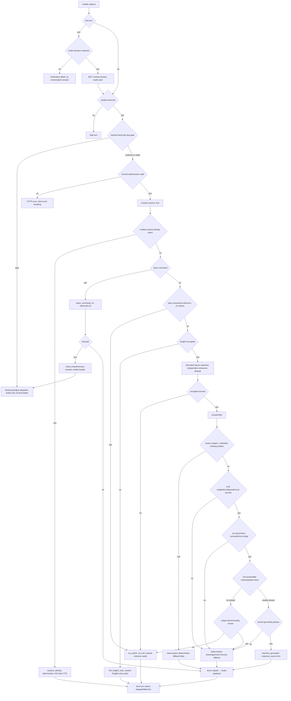

# NEXI Option 5 — Authoritative Source Architecture

Audit date: 2026-10-09. Scope: the current working-tree implementation of **5 — Return user (record, verify, RAG, Jenny, playback)**, including manual and wake variants. This is a source audit, not a redesign or a production-readiness certification.

Evidence labels used throughout:

- **SOURCE VERIFIED**: traced in the current files and their active imports/calls.
- **TEST VERIFIED**: a test exercises the behavior; this is not proof of microphone/device/provider behavior.
- **LIVE VERIFIED**: requires an actual service/device request. No new live requests, microphone captures, provider requests, or service startups were performed for this documentation-only audit.
- **UNVERIFIED**: runtime availability, deployment configuration, hardware behavior, or a quality claim not established by this audit.

Configuration defaults and the non-secret local working-environment selections below are **not running-process measurements**. Existing code/test changes and the deletions shown by Git (`ENDPOINTS_DOCUMENTATION.md`, `llm_context_builder.py`) were left untouched; this audit did not delete either file.

## 1. Actual top-level architecture

```mermaid
flowchart TD
    Menu["test.py: _interactive → return_user"] --> Mode{manual or wake}
    Mode -- manual --> Space["SPACE start; welcome playback; ENTER first query"]
    Mode -- wake --> Wake["Audio wake-word start/events/stop"]
    Wake --> SpaceWake["Welcome playback"]
    Space --> Capture["Audio record-until-silence/audio"]
    SpaceWake --> Capture
    Capture --> Lease["Central microphone request/acknowledge/release"]
    Lease --> AudioResult{capture result}
    AudioResult -- no_speech --> Retry["Manual: wait ENTER; wake: another bounded capture"]
    Retry --> Capture
    AudioResult -- cancelled/error --> End["finally: shared farewell if started; Audio end; Central DELETE session"]
    AudioResult -- WAV --> First{first usable recording}
    First -- yes --> Verify["Audio verify-speaker: global 1:N scoring"]
    Verify --> Match{decision matched}
    Match -- no --> Reject["Unknown/ambiguous diagnostics; verification_failed playback"]
    Reject --> End
    Match -- yes --> JWT["Audio issues session JWT"]
    JWT --> Session["Central POST rag/sessions; Audio conversation/start"]
    Session --> STT["Audio transcribe language=auto; Groq Whisper"]
    First -- no --> STT
    STT --> Text{usable transcript}
    Text -- no --> Capture
    Text -- yes --> Manual{manual mode}
    Manual -- yes --> StopCheck["Central commands/stop"]
    StopCheck --> Stop{stop_command}
    Stop -- yes --> End
    Stop -- no --> Query["Central rag/query"]
    Manual -- no --> Query
    Query --> Auth["Authenticate; validate/resolve Central session; query lock"]
    Auth --> Context["Central context.resolve"]
    Context --> Identity{verified session identity intent}
    Identity -- yes --> IdentityText["session_identity: deterministic console answer; client skips TTS"]
    IdentityText --> Next["Audio conversation-state before next turn"]
    Identity -- no --> Basic{basic command/social}
    Basic -- yes --> BasicAnswer["basic_command; farewell clears Central context/session"]
    Basic -- no --> Ref{unresolved bare reference with no history}
    Ref -- yes --> Unknown["no_match / not_answerable: cached no_knowledge playback"]
    Ref -- no --> English["langdetect English gate"]
    English -- rejected --> Language["422 english_only; cached non_english_input playback"]
    English -- accepted --> Search["Normalize; bounded clauses; TeachMe semantic search"]
    Search --> Records{independently admitted records}
    Records -- none --> Unknown
    Records -- present --> Plan["build_answer_plan: requested relation and evidence cues"]
    Plan --> Missing{known subject; definitely missing relation}
    Missing -- yes --> Fallback["Intent-aware deterministic response"]
    Missing -- no --> LLM["At most one LLM Service generate call"]
    LLM --> Provider{enabled/configured/provider succeeds}
    Provider -- no --> Fallback
    Provider -- yes --> Gate["Marker/partial-answer handling; lexical grounding validator"]
    Gate -- rejected --> Fallback
    Gate -- accepted --> Answer["teachme_grounded response_source=llm"]
    Fallback --> Speakable["Client source whitelist"]
    Answer --> Speakable
    BasicAnswer --> Speakable
    Speakable --> Farewell{session-ended header}
    Farewell -- yes --> End
    Farewell -- no --> TTS["TTS POST /speak: en + jenny"]
    TTS --> Playback["Audio playback/start; synchronous playback + echo guard"]
    Playback --> Next
    Unknown --> Next
    Language --> Next
    Next -- idle --> End
    Next -- active --> Capture
    SpaceStop["SPACE / wake Stop NEXI event / interruption"] --> End
```



Important differences from an ideal centralized diagram:

1. `test.py` owns the turn orchestration. Central does not orchestrate this path's recording, STT, TTS, or playback.
2. Verification goes **directly to Audio**, which issues the JWT. The first recording is reused for both verification and transcription.
3. Commands precede Central's English gate. Context resolution precedes the pipeline's command/language gate; the separate manual stop check precedes `/rag/query` entirely.
4. Central RAG sessions, bearer JWTs, Audio's global conversation state, and Central's context deque are distinct state mechanisms.
5. `session_identity` is currently text-only in the Option-5 client because it is outside its TTS source whitelist.
6. Compound retrieval currently searches bounded cleaned clauses, not a full-query search plus every clause.

## 2. Exact entry point and active/dead-for-this-flow boundaries

**SOURCE VERIFIED:** `test.py::main()` constructs `LiveRESTClient` and `Sprint2Console`; `_interactive()` maps action `"5"` to `console.return_user(input("Trigger [manual/wake]: ").strip().lower() or "manual")`.

- `Sprint2Console.return_user("manual")` calls `_conversation_loop(mode="manual")`.
- `return_user("wake")` calls `_wake_conversation()`, then the same `_conversation_loop(mode="wake")` after a wake event.
- Any other mode raises `ValueError`; the menu-level exception handler reports the error.
- Local OpenCV, enrollment capture, teaching UI, Vision inference, and recognition are not part of this branch.
- `llm_context_builder.py` is **not imported by this active path**. Its independent history/mood/vision-building capabilities must not be confused with Central's current three-turn context.
- Audio's `/api/v1/conversation/turn`, `/process-command`, `/process-pipeline`, legacy `/record-until-silence`, Central's verification proxy, and legacy `RAGOrchestrator` are not called by Option 5. Their existence does not describe the active flow.

`test.py` imports HTTP/config/UI helpers, not Vision, SpeakerService, TeachMe internals, model code, or SQLite. In this path it neither calculates speaker scores nor creates embeddings nor accesses knowledge storage directly.

## 3. Actual service sequence

All project HTTP calls below use HTTPS client verification; the provider transport also uses HTTPS. `internal` means the configured internal service-token header, not a new user identity.

```mermaid
sequenceDiagram
    participant U as User
    participant T as test.py
    participant C as Central
    participant A as Audio
    participant TM as TeachMe
    participant L as LLM Service
    participant G as Configured provider
    participant S as TTS
    U->>T: Select 5, manual; SPACE; ENTER
    opt Cached welcome WAV absent
        T->>S: POST /speak (jenny, en, welcome text)
        S-->>T: WAV
    end
    T->>A: POST /api/v1/playback/start (welcome WAV)
    A-->>T: Playback completed + echo guard
    T->>A: POST /api/v1/record-until-silence/audio
    A->>C: POST /resources/request (microphone lease)
    C-->>A: reserved + lease_id
    A->>C: POST /resources/acknowledge/{lease_id}
    C-->>A: granted
    U->>A: Real microphone speech
    A->>C: POST /resources/release/{lease_id}
    A-->>T: WAV or 204; capture diagnostics headers
    T->>A: POST /api/v1/verify-speaker (same WAV)
    A-->>T: matched/unknown/ambiguous; matched-only JWT
    alt matched
        T->>C: POST /api/v1/rag/sessions (internal + bearer)
        C-->>T: 201 session_id, idle_timeout
        T->>A: POST /api/v1/conversation/start?user_id=... (bearer)
        A-->>T: Audio conversation started
        T->>A: POST /api/v1/transcribe?language=auto (same WAV)
        A->>G: Groq audio transcription probes + final transcription
        A-->>T: text, language, duration, success
        T->>C: POST /api/v1/rag/commands/stop (manual only)
        C-->>T: stop_command boolean
        alt not a stop
            T->>C: POST /api/v1/rag/query (query, session_id, bearer)
            C->>C: Session/context; identity/basic gates; English; clauses
            loop Bounded retrieval clauses
                C->>TM: POST /knowledge/search/embedding (query_object_name, top_k, similarity_threshold)
                TM-->>C: Scored active facts + objects
            end
            C->>C: Admit, rank, dedupe; answer plan; bounded prompt
            opt Learned evidence needs expression and LLM enabled
                C->>L: POST /api/v1/generate (grounded prompt)
                L->>G: Configured chat/generateContent HTTP request
                G-->>L: Draft text or provider failure
                L-->>C: Text + source/provider/model/elapsed or failure
            end
            C->>C: Grounding or deterministic fallback; append context/audit
            C-->>T: Answer, source, IDs, LLM/fallback/context metadata
            opt Source teachme_grounded or basic_command; not farewell
                T->>S: POST /speak (answer, en, jenny)
                S-->>T: WAV
                T->>A: POST /api/v1/playback/start (WAV)
                A-->>T: Completion + echo guard
            end
            T->>A: GET /api/v1/conversation-state (before subsequent turns)
        else stop
            T->>T: Break; no RAG and no LLM
        end
        T->>A: POST /api/v1/playback/start (cached goodbye/idle WAV)
        T->>A: POST /api/v1/conversation/end?user_id=... (bearer)
        T->>C: DELETE /api/v1/rag/sessions/{session_id} (internal)
    else rejected
        T->>A: POST /api/v1/playback/start (verification_failed WAV)
        T->>T: Return; no conversational session
    end
```

The active `TeachMeConnector.search_by_embedding()` uses **POST with query-string fields**, not a JSON embedding body. Its query argument is text: the semantic query embedding is generated inside TeachMe.

Wake variant adds `POST /api/v1/wake-word/start?event_mode=true`, repeated `GET /api/v1/wake-word/events?timeout=0.5`, then `POST /api/v1/wake-word/stop`. Once started, a background thread polls `GET /api/v1/poll-stop-word?timeout=0.5`. SPACE calls `POST /api/v1/interrupt-playback`, also stopping an active capture. These calls are additive to the shared turn sequence, not a second RAG pipeline.

## 4. REST contract inventory and authentication

The effective paths below resolve router prefixes. Central uses port 8000, Audio 8002, TTS 8003, TeachMe 8004, LLM 8006 by default. Configurable URLs, TLS CA, and process environments can change hosts/ports. No Vision endpoint participates.

### 4.1 Client → Audio

| Method / full path | Caller and input | Fields used downstream | Authentication and failure behavior |
|---|---|---|---|
| POST `/api/v1/record-until-silence/audio` | `test.py`; no media upload; service records its microphone | WAV bytes; capture end reason/duration, chunk counts, speech-active/duration/RMS/peak headers; 204 for no usable capture | Explicit `require_internal_service`; microphone lease failure gives service error; capture cancellation/no-speech skips STT |
| POST `/api/v1/verify-speaker` | `test.py`; multipart `file=conversation.wav` | `is_verified`, `decision`, `user_id`, `access_token`, confidence/similarity, top1/top2, margin, threshold, required margin, candidate count | Internal-token middleware protection; 10 MiB upload guard; exceptions produce error; only matched issues token |
| POST `/api/v1/transcribe?language=auto` | `test.py`; same first WAV, then each new turn WAV | `text`; client does not use returned language as Central's English decision | Internal protection; multipart upload; missing/invalid/too-short media and provider failure return errors; loop reports/skips unusable text |
| POST `/api/v1/conversation/start?user_id={id}` | `test.py`; no JSON turn body | HTTP success establishes Audio conversation state | Session ownership dependency; client bearer; trusted internal-user path also supported |
| POST `/api/v1/conversation/end?user_id={id}` | Client teardown; Central expiry worker can call it too | HTTP result; resets Audio global conversation | Same ownership check; teardown is not JWT revocation |
| POST `/api/v1/playback/start` | `test.py`; multipart WAV | `success` and playback result; completion includes echo guard | Explicit internal dependency and middleware; filename must be `.wav`; unavailable manager/playback failure 503 |
| POST `/api/v1/interrupt-playback` | SPACE callback; no body | Cancels capture event and/or playback manager | **No explicit service/session dependency or protected-prefix middleware coverage on this route**; unavailable capabilities 503 |
| GET `/api/v1/conversation-state` | Before later turns | `state`; `idle` ends loop | **No auth dependency/protected-prefix coverage**; client does send internal credentials |
| POST `/api/v1/wake-word/start?event_mode=true` | Wake variant | Starts event mode | Event-mode branch requires internal service identity; setup/model failure reported |
| GET `/api/v1/wake-word/events?timeout=0.5` | Wake poll | Wake event or no-event result | Internal dependency; cancellable client request |
| POST `/api/v1/wake-word/stop` | Wake cleanup | HTTP result | **No explicit auth dependency/protected-prefix coverage** |
| GET `/api/v1/poll-stop-word?timeout=0.5` | Wake-only background polling | Stop event triggers shared session stop | **No explicit auth dependency/protected-prefix coverage**; errors end poller, leaving SPACE fallback |
| GET `/api/v1/orchestration/health` | Wake no-event diagnostic | Readiness/degraded detail | Unprotected diagnostic route; client does not mark this call internal |

### 4.2 Client → Central

| Method / full path | Request / response | Authentication / errors |
|---|---|---|
| POST `/api/v1/rag/sessions` | Client sends no query history; bearer identifies user. 201 returns `session_id`, `idle_timeout` | Internal dependency **and** `require_bearer_session_claims`; an internal token alone is insufficient |
| POST `/api/v1/rag/commands/stop` | `RAGQueryRequest`: `query`; response `stop_command` | `require_session_claims`; Option 5 uses bearer only; no semantic search or LLM; endpoint itself does not delete context |
| POST `/api/v1/rag/query` | `query`, `session_id`; `RAGQueryRequest` query cap 2000, extra fields forbidden; response detailed below | `require_session_claims`; cross-user session 403; missing/expired explicit session 410; English rejection 422; downstream/DB exceptions may give 500 |
| DELETE `/api/v1/rag/sessions/{session_id}` | Idempotent 204; clears context/removes session | Internal dependency; not a bearer-owner check on this delete endpoint |

### 4.3 Backend → backend

| Method / full path | Caller → callee; input/result | Auth / failure |
|---|---|---|
| POST `/resources/request` | Audio microphone lease → Central; query `resource_type=microphone`, service `audio_direct_voice`, active-conversation priority, timeout; reserved lease required | Internal token, verified TLS; 2-second client timeout; queued/failed lease does not wait in the capture route |
| POST `/resources/acknowledge/{lease_id}` | Audio → Central; reserved → granted | Same internal transport; must return granted |
| POST `/resources/release/{lease_id}` | Audio capture finally → Central | Same transport; accepts 200/404; failure can affect request cleanup (section 24) |
| POST `/knowledge/search/embedding` | Central `TeachMeConnector` → TeachMe; query text `query_object_name`, `top_k`, `similarity_threshold`; scored records | TeachMe `require_api_key` uses project service auth; internal + trusted user header sent; retries/circuit may ultimately return empty candidates |
| POST `/api/v1/generate` | Central `LLMServiceClient` → LLM; query contains assembled grounded prompt; language `en`, requested max tokens 256, temperature 0.2 | Internal service auth; provider failure/timeout/error becomes deterministic Central fallback |

Speaker initialization/synchronization additionally calls **GET Central `/users/list`**, internal-token authenticated, to reconstruct Audio's candidate index. It is a **startup/sync dependency**, not a per-turn Option-5 call. Explicit Audio `POST /api/v1/speaker-sync` is not called by `return_user()` itself.

### 4.4 Client → TTS

**POST `/speak`**, no `/api/v1` prefix. Internal auth; JSON `SpeechRequest` with `text`, `language="en"`, `voice_id="jenny"`. Returns `audio/wav` bytes, not an audio-file path. Used for learned/social answers and cache-missing fixed prompts. Request text validation, unavailable voice/model, queue/synthesis timeout, or synthesis failure return errors. Client requires an OK RIFF payload before playback.

## 5. Speaker Verification Architecture

**SOURCE VERIFIED:** `advanced_routes.verify_speaker()` → thread pool → `SpeakerService.identify_speaker()` → `generate_embedding()` → Resemblyzer `VoiceEncoder` → `identify_embedding()`. Shared helpers validate vectors and compute cosine scores; `identify_embedding()` owns matched/unknown/ambiguous decision logic.

### 5.1 Capture and preprocessing

- Audio, not `test.py`, opens the microphone. `AUDIO_INPUT_DEVICE` can select a PyAudio index or uniquely matching device name. An empty selector uses the default input; no default match falls back to the first enumerated input. Invalid/ambiguous overrides raise, rather than silently switching.
- Active VAD capture defaults to 16,000 Hz, mono, signed 16-bit PCM, WAV. A configured 512-sample chunk is normalized to a supported 30-ms 480-sample VAD frame.
- File loading in SpeakerService supports WAV via SciPy and other formats via librosa; stereo is averaged to mono. int16/int32 samples are normalized by their ranges; floating WAV data remains float32.
- `generate_embedding()` uses Resemblyzer `preprocess_wav(..., source_sr=sample_rate)` for the embedding path. Enrollment/process-voice and identification share this generator. STT's separate enhanced preprocessing is **not** the speaker embedding path.
- Raw audio shorter than `min_speech_duration=1.0` seconds is rejected by the speaker service. This is distinct from capture's speech detection and STT's hardcoded 0.5-second minimum. A valid short command after first-turn verification need not undergo speaker verification again.
- Resemblyzer encoder initializes lazily under a lock. Actual asset availability/model load latency is UNVERIFIED in this audit.

Active capture VAD is a two-stage decision: energy first, then WebRTC when available. `VADRecorder` passes only sample rate to `VoiceActivityDetector`, so the detector's defaults (adaptive energy threshold 0.01, WebRTC mode 3) apply rather than every value in the separate `VAD_CONFIG` dictionary. Energy history is bounded to 50 entries; adaptation uses the median after enough samples, adds its offset and clamps the threshold to 0.005–0.05.

Recorder input is int16 converted to float32 **without** dividing by 32768 before the energy check. The energy helper only performs that division for an int16-typed input; the float input takes its other branch. WebRTC receives the samples cast back to int16. Consequently energy and normalized diagnostic RMS do not have the same scale. This is a source-supported mismatch, not a new microphone threshold diagnosis.

Speech activation requires three consecutive speech frames (90 ms at the default framing); the pending frames are retained when activation occurs. After activation, trailing silence is quantized to approximately 17 frames/510 ms for a 500-ms target. Before activation, silence does not end recording after 500 ms: the safety/cancel limits control the no-speech wait. Capture's configured maximum defaults to `VAD_MAX_RECORDING_SECONDS=30`; `main.py` passes it explicitly. End reasons include `speech_end`, `no_speech`, `safety_timeout`, and `cancelled`. Returned WAV duration counts retained buffered samples, not all elapsed waiting time. Recorder buffer survives on the recorder instance until the next recording/reset, without intentional permanent capture-file storage.

### 5.2 Enrollment, candidate index, and scoring

Central's canonical voice field is `voice_embeddings: list[list[float]]`, each valid vector 256-dimensional. Compatibility accepts legacy flat plural and singular `voice_embedding`. Validation rejects wrong dimensions, non-finite entries, non-numeric/boolean entries, and zero norms; it does not invent a vector.

For each accepted user, candidate rebuilding computes the mean of the validated **raw sample vectors**, then normalizes the mean to one unit centroid. It does **not** independently unit-normalize every sample before averaging and does **not** score several prototypes and take a per-user maximum. There is one centroid candidate per user.

`build_candidate_index`/replacement logic collects users, validates all relevant samples, records skip reasons/counts, persists the new encrypted JSON index, and swaps the complete candidate map under an `RLock`. Failed rebuild/persistence does not partially replace the prior index. The persisted filename is configurable via `SPEAKER_EMBEDDINGS_FILE`; its default relative path can resolve differently with service working directories. Legacy pickle migration is restricted rather than unrestricted arbitrary deserialization.

Identification takes a stable candidate snapshot. Shared cosine scoring normalizes query/candidate norms, uses floating-point vector arithmetic, clips to [-1, 1], ranks all users globally, then applies one decision policy. Sorting is descending score with user ID as a deterministic tie-order key; this ordering does **not** turn ties into identities.

| Decision condition | Result | Session/JWT |
|---|---|---|
| No candidates | `unknown` | None |
| Top1 below absolute threshold | `unknown` | None |
| Top1 at/above threshold; top2 exists; top1-top2 **≤** required margin | `ambiguous` | None |
| Top1 at/above threshold; top2 exists; margin **>** required margin | `matched` | Audio issues JWT for top1 |
| Exactly one candidate; top1 at/above threshold | `matched`, margin absent | No fake top2 required |
| Exact top1/top2 tie | `ambiguous` | None |
| Speaker/model/decode/service error | HTTP error, not arbitrary identity | No successful verification |

Absolute threshold default: **0.759**, `SPEAKER_VERIFICATION_THRESHOLD`. Separation default: **0.1084**, `SPEAKER_MIN_MARGIN`. These are config defaults, not proof of the current running process. Source comments describe provisional calibration history; that dataset/calibration was not reproduced in this audit. No threshold was changed.

The route returns `is_verified = (decision == "matched")`; it does not use displayed rounded confidence to recalculate this boolean. Confidence/similarity are rounded to four places, while ranking uses the unrounded score; top candidate diagnostics preserve more decision detail. Thus a score above the absolute threshold can correctly be rejected for insufficient separation. Console speaker diagnostics show decision, top1/top2, required threshold/margin and candidate count, not just a two-decimal confidence.

### 5.3 Index freshness and retained waveform cache

Startup/explicit synchronization fetches Central users with an internal request and a 10-second timeout. An unavailable Central preserves the last usable Audio index; it does not prove freshness. No per-turn verification forces a fresh synchronization. Candidate counts/user identities and actual enrollment ownership are UNVERIFIED without running services.

`FilePreprocessCache` is a process-global, lock-protected LRU of up to 32 waveform/sample-rate entries keyed by absolute path and mtime. **It has no TTL.** A missing deleted file returns a miss but does not immediately erase an existing cached array; eviction/restart ultimately removes it. This is bounded transient retention, not a guarantee that all waveform bytes disappear as soon as a request's file is deleted.

## 6. Central Session Architecture

There are four separate identities/state scopes:

| Item | Meaning | Storage / expiry |
|---|---|---|
| `user_id` | Persisted enrolled user's identity | Central user store |
| Audio-issued session JWT | Bearer credential with user subject | Client memory; signed HS256; default 30-minute expiry |
| Central `session_id` | UUID hex for this RAG conversation | `_rag_sessions` in Central memory; default 300-second inactivity expiry |
| Audio conversation state | Device/conversation lifecycle | Global Audio state machine; not a map keyed by Central session ID |

`RAGSession` holds `user_id`, `verified`, `last_entity`, monotonic `last_activity`, `turn_count`, a `ConversationContext`, an `asyncio.Lock` (`query_lock`), `speaker_verified`, and `verified_display_name`. Explicit POST-session creation requires the bearer and sets speaker-verified state; display name is read from Central's current `app.state.db` user record. The session does not contain a voice vector.

JWT validation checks signature, issuer `nexi-system`, expiry and session token type. Shared secret rotation can accept a previous secret. Closing this RAG session **does not revoke the issued JWT**, and the Option-5 client does not clear its `Session` object in teardown. `Session.valid()` exists with a five-second expiry safety buffer, but the conversation loop does not use it to renew/reverify automatically.

`require_session_claims` distinguishes bearer users from trusted internal calls. An internal call requires a trusted-user header; an internal token is not itself a user identity. POST `/rag/sessions` deliberately uses the stronger bearer-specific validator even when an internal header is present. Auth-disabled behavior exists in shared utilities and must not be mistaken for the configured authenticated deployment.

Central session lookup rejects cross-user access and explicit missing/expired IDs. Inference is serialized per RAG session by `query_lock`, not globally across users. Session activity/turn accounting begins before generation; long inference does not automatically mean the entire idle lifetime is renewed at answer completion.

`evict_idle_rag_sessions()` and `rag_session_eviction_loop()` remove idle contexts/state. Default scan interval is bounded from the idle setting (normally five seconds). Expiry queues an Audio `/conversation/end` call with trusted internal user identity. Because Audio conversation state is global rather than keyed by this RAG UUID, Central-session isolation and physical Audio-conversation isolation are different guarantees.

DELETE-session clears context with `session_closed`; user invalidation calls `delete_rag_sessions_for_user`; farewell through `/rag/query` clears/removes with `goodbye`. Process restart restores no RAG sessions or context. There is no hard maximum number of active RAG-session dictionary entries, only inactivity cleanup.

## 7. Speech-to-Text Architecture

`advanced_routes.transcribe_audio()` saves an upload to a temporary WAV, checks decode/non-empty/minimum 0.5-second duration, then calls `STTService.transcribe_with_metadata()`. The active async endpoint calls this synchronous STT method directly; it is not the speaker endpoint's thread-pool execution pattern.

Actual provider: Groq audio transcription SDK, using `GROQ_API_KEY` and `STT_MODEL` (default `whisper-large-v3`). This is independent of `LLM_PROVIDER`; selecting Gemini/OpenRouter for expression does not switch STT. The SDK is initialized without this code specifying a per-request generation timeout.

**Language policy is auto in Option 5**, not forced English:

1. Client explicitly submits `language=auto`.
2. STT probes short raw WAV segments (up to two probes, beginning/middle where duration supports it), using verbose JSON without a forced language.
3. Returned language/script votes may select English or Urdu. If unresolved, the service uses its existing heuristic and may probe processed audio again.
4. Enhanced preprocessing defaults on: target 16 kHz, normalization, noise reduction, librosa silence trim (`top_db=30`, frame 2048, hop 512).
5. Final transcription uses temperature 0 and verbose JSON; a language parameter is included only when effective language is not auto.
6. English prompt hint is hardcoded: **“This is clear English speech. Common words: name, student, semester, university.”** Urdu has its own hint. This is a domain-biased ASR hint, not taught knowledge.
7. Main transcription has up to three attempts with one-second retry delay; language probes are additional provider requests. One turn does not imply one STT-provider request.

STT concurrency semaphore defaults to one; its 30-second acquisition timeout is not the same as setting the SDK network-call timeout. Quality-validation logic accesses configuration absent from the current enhanced config and catches the resulting exception, accepting with a fallback quality result. Therefore quality gating is not proven strict just because the feature is mentioned in comments.

Returned fields include `text`, `language`, rounded duration, success, timestamp, and `confidence=None`. Option 5 acts on `text`; Central validates the text language separately. Configured English hints do not guarantee Latin-script English output.

Raw request upload deletion is in endpoint `finally`. Probe WAVs have cleanup. The processed STT WAV cleanup is after the main retry loop rather than an unconditional encompassing `finally`; an all-attempts-failed exception can bypass that cleanup. No current live STT accuracy/latency is established here.

## 8. Language Validation Architecture

`restricted_rag.require_english()` uses `langdetect.detect_langs`, with `DetectorFactory.seed=0`.

Actual order:

```text
manual stop endpoint (client-side REST gate)
→ Central session validation and context resolution
→ runtime-session identity gate
→ basic command/social classifier
→ unresolved-reference/no-history guard
→ English validation
→ retrieval and answerability
```

English detected at top rank passes without a minimum confidence requirement. Non-English detected text can still pass if it is ASCII and contains at least two distinct English marker words and either has at most `RAG_LANGUAGE_MIN_TOKENS=5` tokens or has non-English confidence below `RAG_LANGUAGE_CONFIDENCE_THRESHOLD=0.90`. These are short-question protections, not a rule that every input shorter than five tokens is invalid.

Hardcoded markers: `what which where when who why how does do is are can could would should tell explain about please you your me my the i to going am`. Detector exceptions/empty results fail the English check. Rejection is HTTP 422 with detail code `english_only` and diagnostics; `test.py` plays the existing non-English prompt, then keeps the session loop available.

STT language selection, Central English validation, LLM's `language` field, and TTS language routing are separate mechanisms. LLM generation does not use its request language field to force a language. TTS receives explicit English and bypasses its automatic detection for this flow.

## 9. Command and Social Handling

`01_central_server/basic_commands.py::classify_basic_command()` is the deterministic transcript classifier used by both Central `/commands/stop` and the restricted pipeline. It is not an Audio acoustic keyword matcher.

Starter literals include greetings (`hello`, `hi`, morning/afternoon/evening greetings), farewell (`goodbye`, `bye`, `see you`, `that's all`), `stop`, `thank you`, `thanks`, `okay`, `ok`, `cool`, and `help`. Responses include `Hello!`, `Goodbye!`, `Stopping.`, `You're welcome!`, `Okay!`, `Cool!`, and the learned-knowledge help instruction. The starter list is hardcoded, not dynamically learned.

Normalization uses casefold, ASCII `[a-z0-9']+` tokenization, whitespace joining, and conversion of `good bye` to `goodbye`. A bounded farewell regex permits an optional acknowledgement (`okay`, `ok`, `cool`, `thanks`, `thank you`) followed by repeated farewell tokens; punctuation is discarded. It does not interpret arbitrary sentences containing a stop word as a stop command. Curly apostrophes are not the same as ASCII apostrophes under this tokenizer.

`RAG_FAREWELL_PHRASES` is a configurable JSON list defaulting to `bye`, `goodbye`, `see you`, `that's all`, `stop`. `is_stop_command` still requires the basic classifier to recognize the phrase. Adding an unrelated custom phrase to the environment list alone does not add a new classifier intent.

Manual spoken stop: transcribe → `/commands/stop` → break → shared cached goodbye playback → Audio end → Central DELETE. No RAG/LLM request. The command-check endpoint alone does not clear context. Wake mode lacks this separate manual transcript gate; farewell goes through `/rag/query`'s early basic-command branch, which clears Central context/session, sends the ended header, and reaches the same client farewell helper. Acoustic `Stop NEXI` events use Audio's stop detector and the wake client's poller; they are not the transcript classifier.

SPACE stops the session through `SpaceSessionStop`, interrupts ongoing recording/playback, and leads to the same teardown. Shared goodbye playback is attempted once per teardown; if playback fails, cleanup is still attempted.

## 10. Short-Term Conversation Context

Owner: Central. Module/class: `conversation_context.py::ConversationContext`. Storage: a `deque(maxlen=CONTEXT_MAX_TURNS)` on each `RAGSession`; not a separate database/history service.

Defaults: enabled, max three turns, TTL 900 seconds; configured max is clamped to 1–3. Text is whitespace-compacted and capped at 512 characters per field. Session's 300-second inactivity expiry can remove it earlier than the context's own 900-second TTL.

Actual stored immutable `ConversationTurn`:

```text
user_query: compact original user query
nexi_response: compact final response
retrieved_record_ids: tuple of IDs
topics: tuple of selected canonical topic texts
timestamp: wall-clock time
```

Separate context fields track monotonic activity and reset reason. Snapshot expires at the TTL boundary. Appending refreshes activity and clears the prior reset reason. Sliding counts are 0 before the first response, then 1, 2, 3, 3, 3. No audio, embeddings, provider payloads, or credentials are included.

### 10.1 Resolution algorithm, not general coreference

`resolve()`:

1. Empty/expired history: leave query unchanged.
2. Named references can search all retained turn topics for a **unique lexical match**, e.g. `tell me again about …` or `what about the/that/this …`.
3. Explicit new topics (`what about my/our/your/the/a/an …`) are converted to a topic query without borrowing prior facts.
4. Otherwise only **the latest turn's topics** are antecedents. Empty latest topics do not resurrect an older successful topic.
5. Multiple topics require a bounded first/second/other reference (the other is only unambiguous with two topics). Ambiguous bare `why` does not choose arbitrarily.
6. One topic supports bounded pronouns `it/that/this/them`, standalone `why/how`, `tell me more`, `what you just said`, and specific `where is/are`, `what is`, `what about`, `tell me about` forms.
7. Property follow-ups such as `why is it …` replace a supported pronoun with the selected topic. Resolution creates a retrieval query, not a new factual claim.

There is **no general semantic coreference model, vector ranking of history, permanent topic graph, or separate last-successful-grounded-subject object**. `RAGSession.last_entity` is a separate legacy anchor, updated from grounded fact subject where available; when context is disabled, the legacy pronoun replacement still exists. Disabled context is therefore not identical to removing all legacy reference handling.

### 10.2 Append/reset/authority rules

Central appends most non-basic-command results, including unknown/not-answerable/session-identity responses. An unknown turn can have no topics and deliberately stop the latest-topic anchor. Basic social commands are not appended. Context is cleared on TTL, explicit close, session expiry, user invalidation, farewell handled in RAG, or service restart. Manual stop clears through DELETE-session teardown.

Recent turns are appended to the expression prompt oldest→newest with a newer-turn priority instruction and an explicit **history is untrusted, not factual authority** rule. Only current approved knowledge is allowed as factual evidence. This is prompt-level separation plus grounding against approved current facts; it is not an independent semantic history validator.

No network call fetches context. Per-session query lock protects turn ordering. Cross-user session checks isolate these deques. Safe response metadata includes enabled/count before/count after/used/reset reason/resolved subject/requested relation/property-known. The console does not have its own context state; normal source diagnostics and debug JSON are the visibility paths.

## 11. Restricted RAG Architecture

Active implementation: `RestrictedRAGPipeline.answer()` in Central. Candidate provider: `TeachMeConnector.search_by_embedding()` → TeachMe `app.search_by_embedding()` → semantic query embedding → `PersistentKnowledgeBase.search_by_embedding()` → `EmbeddingIndex.search()`.

### 11.1 Query normalization and clauses

`normalize_retrieval_query()` applies environment JSON replacements, strips configured filler phrases longest-first with word boundaries, and compacts whitespace. Default rewrite includes **`where is my home` → `where is my hometown`**. This is a genuine domain-specific semantic alias; it can conflate a residential-location question with origin. No bottle-specific response branch was found in the active production composition path.

Default filler phrases: `do you know anything about`, `do you know`, `can you tell me`, `could you tell me`, `would you tell me`, `anything about`, `please tell me`, `tell me about`, `basically`.

`_retrieval_clauses()` uses bounded deterministic connectors `and` (optionally `also`), `also`, `as well as`. Normally a connector must introduce a determiner (`my/our/your/the/a/an/this/that/these/those`); a `both` form relaxes that constraint. Thus not every natural conjunction splits. `RAG_TOP_K<=1` disables splitting. Empty/malformed resulting parts revert to the original single query.

`_clean_compound_clause()` repeatedly strips generic wrapper forms (`please`, `naturally`, `both`, polite “can/could/would you”, “tell me”, “what … know/remember/about”) and trailing “I taught/told/showed you [about]”. No LLM decomposition occurs.

| Query structure | Actual searches / embeddings |
|---|---|
| Single topic | One TeachMe search; one query embedding on search-cache miss |
| Compound M clauses | M sequential TeachMe searches, bounded by Top-K; M embeddings on cache misses |
| Full-query supplement | **Not performed in the current compound path** |
| Stored records | Existing semantic vectors reused; not generated per query |

### 11.2 Knowledge and embedding spaces

Semantic model: `sentence-transformers/all-MiniLM-L6-v2`, **384 dimensions**, local-files-only initialization, normalized representations. This is not Resemblyzer's 256D speaker space and not Vision visual/instance space.

Facts use subject/predicate/object textual representation. Objects use canonical name, meaningful description, and category where not already redundant. Legacy auto-generated detector/confidence descriptions are excluded from semantic text. Object semantic embedding version/hash (`shared/semantic_embeddings.py`) detects stale canonical text/model representations; refresh happens during knowledge load/rebuild/learn/update, persists once, and does not alter visual/instance fields.

TeachMe searches active facts **and objects**, with no item-type filter for this path. Forgotten objects/facts are removed from active storage/index. The optional existing FAISS path uses normalized `IndexFlatIP`; default `USE_FAISS=true` only enables it if the dependency is available. Otherwise a linear cosine search is used. This is an existing optional index, not proof that a new vector database is required or running.

### 11.3 Admission, ranking, deduplication

Defaults in Central:

- `RAG_MATCH_THRESHOLD=0.55`: direct score admission.
- `RAG_CANDIDATE_THRESHOLD=0.45`: lower candidate band.
- `RAG_BAND_QUERY_COVERAGE_RATIO=1.0`: lower-band admission requires complete meaningful query-term coverage by the record.
- `RAG_TOP_K=3`: final bounded context size and clause limit.

TeachMe threshold is `min(candidate, match)` and response similarity is rounded to four decimals before Central sees it. Central checks each record **against its own searched clause**, not just the original compound query. It keeps the best accepted score per stable record ID (canonical text fallback for ID absence), sorts globally, and selects bounded final Top-K. A strong clause-B record does not directly suppress clause-A admission, although final Top-K remains a global limit.

No nearest record is forced into empty slots. No accepted candidates → source `no_match`, no LLM. Candidate type and score can be diagnosed without vectors. Prompt ordering/topics may follow query order while response ID ranking follows score order.

### 11.4 Caches and connector limitations

The Central query schema accepts up to 2000 characters, but TeachMe's search text accepts **200**; Top-K is constrained to 1–50 and threshold to [0, 1]. Its input sanitizer rejects prohibited patterns including angle/brace delimiters, semicolons and SQL-comment syntax. A long Central clause can therefore fail downstream rather than successfully search. No independent shortening to the TeachMe contract is implied by Central's longer limit.

TeachMe search cache: key includes query, Top-K, threshold; TTL 300 seconds; max 1000 entries. It does **not include user ID**. Search queries do not filter records by the authenticated user in this active implementation: knowledge is a shared store, despite trusted-user identity transport. Do not equate isolated conversation context with isolated learned-knowledge ownership.

No search-cache invalidation on learn/forget was found in the audited mutation paths. A cached result can therefore outlive a mutation until expiry. Responses serialize object data, which can include visual/instance fields across the internal TeachMe→Central boundary; Central's prompt renderer selects only safe textual fields before the LLM boundary.

Connector retries default three, timeout 15 seconds, exponential delays 1/2 seconds, circuit failure threshold five and recovery 60 seconds. Exhaustion can become empty search results, indistinguishable to the pipeline from no taught knowledge.

`TeachMeQueueManager.enqueue()` appends to a deque limited to 1000; `mark_completed()` decrements active count but does not dequeue these entries, and search does not invoke `can_process()` to enforce its advertised ten-concurrent limit. At sustained usage the queue can fill and reject new searches. This is a **source-supported scalability weakness**, not a live load-test result. The connector's constructor default URL is `https://localhost:8004`; passing a URL only inside its config dictionary is not equivalent to overriding its `base_url` argument.

## 12. Hardcoded / Configured Semantic Rules

| Rule | Source | Purpose / scope | Classification / risk |
|---|---|---|---|
| `where is my home` → `where is my hometown` | `restricted_rag.py`, default `RAG_QUERY_REWRITES` | Retrieval alias only | Configurable domain-specific default; changes meaning for actual home-location questions |
| Filler phrase stripping | Same, `RAG_FILLER_PHRASES` | Remove conversational wrappers | Config-driven default literals; can remove wording within a larger question |
| ASCII tokenization/possessive removal/glue words | `_tokens`, `_retrieval_terms` | Lexical candidate admission and grounding | Hardcoded/configurable glue; limits multilingual/punctuation behavior |
| Determiner-gated conjunction splitting and wrapper regexes | `_retrieval_clauses`, `_clean_compound_clause` | Bounded compound searches | Hardcoded generic grammar; unsupported forms may remain one semantic query |
| English marker list | `require_english` | Short ASCII English question exception | Hardcoded generic words; not robust language understanding |
| First interrogative maps to relation | `answerability.py` | Location/reason/time/person/identity/description/method | Hardcoded generic map; not arbitrary relation inference |
| Evidence cue regexes | Same | Detect relation support from approved text | Hardcoded generic cues; evidence can be ambiguous/compound-wide |
| Context pronoun, ordinal, named-topic patterns | `conversation_context.py` | Cheap antecedent resolution | Hardcoded bounded generic grammar, not full NLP |
| `do/did you recognize me`, `am I verified` | `restricted_query` | Runtime identity shortcut | Hardcoded bounded intent; **“Who am I?” is not this shortcut** |
| Basic command starter phrases | `basic_commands.py` | Fast deterministic social/stop | Hardcoded, bounded; farewell subset config-driven |
| Student/semester/university ASR hint | `stt_service.py` | English transcription hint | Hardcoded domain-biased hint, not RAG knowledge |
| Object detector-description exclusion | `shared/semantic_embeddings.py` | Avoid technical detector prose in textual memory | Generic representation cleanup, not bottle-specific response |

**No bottle-specific response hardcoding found.** Example nouns in tests/docs are not production query branches. The home→hometown default and ASR education-word hint mean that “no domain-specific rules anywhere” would be an inaccurate claim.

## 13. Intent and Answerability Layer

`answerability.py::AnswerPlan` is a transient dataclass, not persisted. `build_answer_plan(query, records, subject_referenced=…)` produces resolved subject, requested relation, subject-known, and requested-relation-known state.

Relation map: `where→location`, `why→reason`, `when→time`, `who→person`, `which→identity`, `what→description`, `how→method`; no recognized interrogative defaults to description. It is deterministic regex/token logic, not a semantic model or extra LLM call.

Subject comes from selected record `data.subject` or `data.name`. `subject_referenced` uses meaningful lexical query-topic terms; a relevant embedding hit alone does not necessarily establish this condition. With compound records, query-order topic selection and score-order first-record selection are not guaranteed identical.

Description/identity are treated as available. Other relations inspect approved evidence with cue regexes:

| Relation | Representative exact cues |
|---|---|
| location | located, location, address, situated, kept, stored, lives, resides, inside, on the, in the, at the |
| reason | because, reason, due to, so that |
| time | when, date, time, during, before, after, at/on a digit |
| person | who, person, owner, author, creator, given by, made by, taught by |
| method | how, method, process, steps, by using, using, first … then |

The evidence is combined approved text, not a typed fact ontology tied to every individual subject/relation. A cue in another compound record may therefore support the wrong subject. Lack of a cue is definitely missing only for a bounded single label-only object case. Free-form facts, described objects, and compound evidence can be **indeterminate (`None`)**, rather than falsely classified as definitely missing.

This is a small heuristic bridge, **not complete semantic answerability**. For indeterminate cases the one expression request still participates through the not-answerable marker/partial notice. Retrieval alone does not establish that every requested property is answered.

## 14. Known Entity / Missing Property Flow

For a generic label-only taught object and `Where is my water bottle?`:

```text
semantic/lexical admission identifies object
→ requested_relation=location
→ subject_referenced must independently pass
→ no location cue; label-only single object establishes missing property
→ AnswerPlan.missing_response()
→ deterministic teachme_grounded response, no LLM
→ context keeps the selected object topics/IDs
→ Jenny TTS and Audio playback
```

Current generic wording is built as `I remember <subject>, but you haven't taught me where it is.` Subject cleanup removes a leading identification framing, changes standalone `my` to `your`, and trims punctuation. Reason/time/person/method use analogous missing-relation text. This document does not replace that wording with a proposed ideal answer.

For evidence that is indeterminate, the prompt tells the model to mark no answer or append the exact notice `The other requested information is not learned yet.` Central can convert the marker to a partial-known response only when the query is demonstrably about a selected subject. Missing subject instead yields `not_answerable` and the existing unknown path.

Provider failure can call `missing_response(unavailable=True)`, yielding a generic “can't confirm its <relation> from what I've learned” response. Definite missing-property output has `response_source=deterministic` but **`fallback_used=false`**: it is an intentional direct answer, not a failed provider call.

## 15. LLM Expression Architecture

Caller: Central `LLMServiceClient.generate_response()`. Callee: LLM `/api/v1/generate` → `ExpressionService.generate()` → centralized provider factory. Provider details do not leak into `test.py`, TeachMe, or Central route HTTP implementations.

Current non-secret environment selections inspected: `LLM_ENABLED=1`, `LLM_PROVIDER=groq`, `GROQ_MODEL=qwen/qwen3.8-27b`. Other configured model strings: Gemini `gemini-3.5-flash-lite`, OpenRouter `liquid/lfm-2.5-1.2b-instruct:free`. These are configuration selections, **not an availability claim or a fresh successful provider test**.

Factory supports Groq/OpenRouter via shared chat-completion HTTP machinery, Gemini via `generateContent`. Settings validate once at construction; missing key/model, unsupported provider, or invalid generation settings mark capability degraded, not the whole NEXI system unusable. Disabled mode does not require keys. There is no provider cascade and no generation probe at every startup.

Defaults: settings temperature 0.2, max tokens 160, provider timeout eight seconds. Central explicitly requests 256 tokens and temperature 0.2; service caps tokens to its configured maximum. Thus changing environment temperature does not necessarily change this flow's explicit requested temperature. Route clamps request max tokens to 1–512 and temperature to 0–1.5. The route's language field is not used to build a distinct language policy.

Central bypasses Focus resource polling for `request_context="teachme"`. It has a three-failure/15-second-recovery circuit, an outer 90-second wait, and a larger HTTP client timeout; no ordinary retry loop is active. LLM service enforces its shorter provider budget. Threaded blocking HTTP may continue until its own request timeout after an async cancellation.

Provider specifics:

- Groq/OpenRouter: POST `{base_url}/chat/completions`; model from environment; **one user-role message containing the whole constructed prompt**, not separate system/user messages; temperature, max tokens, hardcoded `top_p=0.9`.
- Gemini: POST `/v1beta/models/{configured_model}:generateContent`; key in header; user contents/parts and generation config; thought parts excluded from returned text.
- Shared current/previous-key rotation can retry once on 401/403 within the remaining time budget. Consequently one generation can entail two HTTP attempts under key rotation; ordinary success is one.
- No embeddings or full database are sent to providers. Approved text, current query and bounded recent conversation **do leave the local services**.
- Provider responses return elapsed time and safe source/model/provider data. `tokens_generated` is a word-count estimate, not provider-certified token usage.

## 16. Prompt Assembly and NEXI Persona / Expression Policy

Centralized policy constant: `restricted_rag.py::NEXI_MEMORY_INSTRUCTION`.

Actual instruction, extracted from source:

> You are NEXI, a warm, concise personal companion. Answer only from supplied learned memory, never outside facts, explanations, assumptions, or guesses. Compose a natural conversational answer that directly addresses the question, not a replay of record labels or wording. You may change grammar, pronouns, sentence order, and transitions while preserving factual meaning exactly. Keep learned names and descriptive terms explicit. Preserve the original relationships: identifying something does not establish ownership, location, or use. For object identification, describe what it is, not what the user has or owns; do not replace an identification with a possession claim. Naturalize the grammatical framing, not those factual relationships. Combine multiple memories smoothly into one coherent response, using one sentence or at most two short sentences. Do not mention record types, IDs, scores, retrieval, databases, or metadata. Preserve uncertainty; missing information has not been learned. Answer the requested intent, not merely a related label. Keep a familiar, natural companion tone without adding emotions, explanations, or unsupported details.

“Slightly youthful” is **not** an explicit phrase in the current policy. Persona is centralized, not provider-specific. Related grounding/answerability instructions also occur in prompt introduction, object guidance, compound guidance, final-question framing and context instruction; this is overlapping policy text, not multiple independent persona factories.

`build_grounded_prompt()` uses:

1. An expression-only introduction; a different instruction when multiple memories are combined.
2. The central policy above.
3. Bounded canonical fact/object text; objects may be tagged `[object]` **inside** the prompt while record types are forbidden in the answer.
4. Not-answerable marker and exact partial-notice constraints.
5. Original current user query plus compact recent conversation when present; history explicitly non-authoritative.
6. The resolved question and requested relation; caution not to carry previous missing information into a new intent.

It does **not** send full raw records, all database entries, visual/instance vectors, voice vectors, or a complete structured AnswerPlan object. Relation guidance is included; all internal plan fields are not automatically serialized. The legacy `LLMServiceClient` optional context/knowledge/history arguments are not separately added to its provider payload; Central's assembled `query` already carries the intended textual context.

## 17. Grounding Validation — Exact Algorithm

Function: `restricted_rag.py::is_grounded(response, facts)`, assisted by `answerability.without_attribution()` and `_tokens()`.

Classification: **lexical/rule-based with SequenceMatcher**, not semantic entailment, not embedding similarity, not a second LLM/NLI model. “Validates meaning” is an intended role, not a proven description of this implementation.

### 17.1 Normalization and allowed attribution

Leading `I remember [you told/taught me] [that]` or `You told/taught me [that]` framing is removed. Casefolding, ASCII alphanumeric token extraction, possessive `'s` removal and glue-word removal operate on the remaining answer and approved facts. Unicode entities can lose information under this ASCII tokenization.

Glue words include `a an and are as at be by for from in is i it me my of on or that the this to was we were with you your`. These are grammatical permissions, not a general synonym dictionary.

### 17.2 Claim checks

1. There must be meaningful response claim tokens and approved facts.
2. Split clauses on conjunction `and/but` and sentence boundaries; remove permitted attribution per clause.
3. Every remaining clause's non-glue token set must be a subset of **one** approved fact's non-glue token set. The gate does not approve a clause solely because its words exist across an arbitrary union of unrelated facts.
4. Overall lexical coverage must be at least **0.9**.
5. `SequenceMatcher` similarity on token-joined answer vs token-joined approved evidence must be at least **0.45**.

There is no independent typed entity-preservation pass, numeric-value pass, ownership graph, temporal consistency pass, or logical entailment check. Numbers enter the same token-membership rules as words. New adjectives such as “beautiful/agricultural” fail unless supported by evidence tokens; legitimate synonyms can also fail because their words are not in the evidence. Shared words can pass without proving their complete logical relationship.

The exact partial-knowledge notice is removed for grounding comparison, rather than treated as a new factual claim. Marker/partial handling occurs before this gate. Single-question known-property handling can remove an unnecessary exact notice from the final response.

### 17.3 Fallback trigger

```text
non-empty provider draft
→ marker/partial interpretation
→ compare draft against canonical approved evidence
→ false: discard draft
→ deterministic approved-memory/intent formatter
→ response_source=deterministic
→ fallback_used=true
→ fallback_reason=grounding_rejected
```

This preserves an answer instead of returning a provider's unsafe text, but can reduce naturalization by rejecting safe rephrasings. The client's legacy `source=grounding_failure` branch exists; the current pipeline normally returns grounded deterministic fallback rather than producing that source.

## 18. Deterministic Response / Fallback Architecture

| Reason / branch | Builder and input | Metadata | TTS in actual client |
|---|---|---|---|
| No admitted memory | `TEACH_ME_RESPONSE`: “I don't know this yet. Please teach me.” | `no_match`, deterministic; no provider | Replaced by cached no_knowledge wording/audio |
| Entire requested answer unsupported | Marker/answerability → unknown response | `not_answerable`, deterministic | Cached no_knowledge |
| Definitely missing property of known subject | `AnswerPlan.missing_response()` | `teachme_grounded`, deterministic; fallback false | Jenny |
| Indeterminate property and provider unavailable | Intent-aware unavailable response where applicable | deterministic; failure reason | Jenny |
| LLM disabled | `format_memory_fallback` → shared `format_grounded_response` | fallback true, `llm_disabled` | Jenny |
| Missing key/model/unsupported config | Same safe fallback | concise reason if supplied | Jenny |
| Timeout, HTTP/rate limit, malformed/empty provider response | Same or intent-aware response | fallback true, provider reason/generic reason | Jenny |
| Grounding rejection | Approved memory/intent formatter | fallback true, `grounding_rejected` | Jenny |
| Partial confirmed by marker | Intent-aware or approved partial text | `requested_information_not_learned` | Jenny |
| Social command | `classify_basic_command` literal response | `basic_command`, deterministic, no LLM | Jenny, except farewell handled separately |
| Session identity | Session display-name response | `session_identity`, deterministic, no LLM | **Skipped** by client source whitelist |
| Blank/no usable speech | Capture 204 or Central `no_speech` | No downstream generation | Skipped |
| Stop | Classifier or SPACE/acoustic control | No expression generation | Cached shared goodbye/idle asset |

`shared/grounded_formatter.py::format_grounded_response()` is generic: replace standalone `my` with `your`, capitalize framing, trim terminal punctuation, append sentence punctuation and join approved items. Partial mode adds the exact generic notice. It can retain record-like wording and does not perform a grammatical semantic rewrite. It has no hometown/bottle/phone/university-specific sentence builder.

## 19. Response Source Semantics and Diagnostics

`RAGResult` uses `source` for **route/product category** and `response_source` for **expression origin**; these are not interchangeable.

Actual normal Central response keys are `success`, `response` (not `answer`), `source`, `response_source`, `fallback_used`, `fallback_reason`, `llm_provider`, `llm_model`, `llm_latency_ms`, `retrieved_record_ids`, `context_enabled`, `context_turn_count`, `context_turn_count_before`, `resolved_subject`, `requested_relation`, `requested_relation_known`, `context_used`, and `context_reset_reason`. Blank-speech early return has a smaller response shape with `status=no_speech`; this is an additive metadata contract, not one universal identical body for every branch.

| Field | Current values / meaning |
|---|---|
| `source` | `teachme_grounded`, `basic_command`, `no_match`, `not_answerable`, `session_identity`; route-level `no_speech`; client recognizes legacy `grounding_failure` |
| `response_source` | Lowercase `llm` or `deterministic` |
| `fallback_used` | True after failed/disabled/rejected expression or marker-confirmed fallback; false for intentional direct deterministic routes |
| `fallback_reason` | Optional string; `llm_disabled`, `timeout`, `invalid_response`, `empty_response`, `provider_unavailable`, `missing_model`, `missing_api_key`, `unsupported_provider`, HTTP-code reason, `provider_http_error`, generic `provider_failure_or_disabled`, `requested_information_not_learned`, `grounding_rejected` |
| LLM metadata | Provider/model/latency on accepted LLM output; attempted provider/model/latency are not consistently retained after fallback |
| Grounding/retrieval metadata | Selected IDs/types/scores and prompt facts are handled internally; safe IDs, context and answerability diagnostics returned |

LLM service can report a failure reason outside Central's allowlist (e.g. invalid settings); Central then uses a generic provider error. A successful HTTP response with absent/empty generation is not treated as successful LLM expression.

Central diagnostic headers include query-token/retrieval-term counts, best similarity, session ID, session-ended flag, session turn count and idle timeout. `test.py` displays returned response source/provider/model/latency/fallback/IDs in manual or debug mode. It does not determine expression source itself. Counts of client record/verify/transcribe/RAG/speak/playback calls do not count hidden STT probes, connector retries, provider key rotation or resource leases.

## 20. Runtime Session Identity

The exact current shortcut recognizes **`Do/Did you recognize me?` and `Am I verified?`** using bounded normalized matching. `Who am I?` is not the same shortcut and goes through ordinary restricted handling unless another applicable command exists.

It reads `RAGSession.speaker_verified` and `verified_display_name`, established at the bearer-verified session creation. Display name is from Central users, not TeachMe. No semantic embedding, TeachMe lookup, external LLM, or confidence disclosure is required.

Current contract defect/behavior visible from code: `source=session_identity` returns a text answer, but the client's speakable-source set is only `teachme_grounded`/`basic_command`. Therefore identity text exists while Jenny playback is skipped. This is **SOURCE VERIFIED**, not a fresh microphone test. This task does not fix it.

## 21. TTS and Playback

TTS service function `tts_service.app.speak()` validates text/voice/language, submits to `ParallelWorkerPool`, and returns in-memory WAV bytes. `EngineManager.synthesize()` uses explicit English to choose Piper. Jenny model is `en_GB-jenny_dioco-medium.onnx` with its adjacent config, discovered under deterministic `PIPER_MODELS_DIR` (default service `models` directory). Registry/model availability is runtime-dependent; models are lazy-loaded into worker caches.

Jenny is explicitly requested by Option 5 regardless of the mutable global default voice. The service singleton currently defaults to Jenny; engine-level absent-voice fallback to Ryan is not normally relevant because the client supplies Jenny.

TTS text max defaults 5000. Queue timeout 60 seconds plus synthesis timeout 60 seconds bound submission; the client's 90-second default request timeout can expire earlier than the aggregate 120-second service budget. Errors are recorded server-side and returned with HTTP status; the client skips that turn's playback and continues on ordinary non-OK responses.

`_play_audio_bytes()` serializes Audio playback with a client lock and uploads WAV; it does not use a local TTS engine. Audio `start_playback()` runs `PlaybackManager.play_audio_bytes()` in a thread, then waits `AUDIO_ECHO_GUARD_SECONDS` default **0.75 seconds**, clamped to 0–3. Thus its HTTP completion means playback plus room/device-tail delay, not merely queued playback.

Fixed prompt WAVs live intentionally under `04_tts_service/voices`; `_play_cached_prompt()` reads them, or synthesizes their configured literal text if absent. Relevant prompts: `session_start`, `verification_failed`, `non_english_input`, `no_knowledge`, `session_end_idle`, `session_end_normal`. Fixed unknown wording at playback is “I'm not familiar with this yet. Could you teach me?” Normal farewell is “Goodbye!” Idle farewell is a different existing asset/text.

The normal answer's TTS WAV remains in response/client memory and Audio playback memory; no intentional persistent answer-WAV path is returned to the client. `PlaybackManager` parses WAV from bytes, keeps `current_audio`, and joins its playback thread with a hardcoded 300-second limit. Buffer lifetime is not an explicit zero-retention guarantee at HTTP completion. Audio capture/STT request files are separate from TTS bytes. Cached prerecorded prompts are intentional runtime assets, not disposable request artifacts.

## 22. Exact Conversation Loop and Exit Conditions

1. Manual waits SPACE before starting; plays welcome, then waits ENTER for the first query. Wake waits for a wake event and starts the same flow.
2. Record via Audio, skipping everything downstream for 204 no-speech/cancel.
3. First usable WAV verifies identity and opens Central/Audio sessions; subsequent turns do **not** reverify speaker.
4. Transcribe every usable turn, including the first verification WAV.
5. Manual transcript stop gate precedes RAG. Otherwise query Central.
6. Language rejection/unknown branches may play cached feedback. Learned/social answers use Jenny when source is allowed.
7. Audio playback completion includes echo guard.
8. Before the next turn, query Audio conversation state. `idle` breaks; otherwise capture begins automatically. Manual no-speech waits for deliberate ENTER, avoiding an uncontrolled immediate retry cycle.
9. SPACE cancels active requests and recording/playback. Wake acoustic stop event enters the same shared end behavior.
10. Finally: stop thread flags/join, close watcher, attempt goodbye/idle playback if started, end Audio, delete Central session.

`SpaceSessionStop` Windows watcher polls with ~30-ms sleep; request cancellation polls ~25 ms; disconnect monitor ~25/50 ms. The **initial** Windows `_wait_for_spacebar()` uses a direct key loop without a sleep. No-speech does not call STT/RAG/TTS or create another session; wake may continue bounded capture attempts.

Exit paths: speaker rejection; explicit stop; cancelled capture; idle Audio state; unhandled transport/error; failed initial session setup; menu cancellation/interruption. Non-OK STT/RAG/TTS/playback responses commonly skip the turn rather than end the session. Explicit Central session expiry produces 410; client does not automatically renew/reverify it.

## 23. Central Idle vs Audio Idle vs Credential Expiry

These must not be described as one timeout:

- Central RAG idle default: **300 seconds** since session activity, cleanup worker/lookup enforce it.
- Audio conversation state's configured inactivity default: **10 seconds**, independent of RAG UUID. Its transition/timer depends on Audio state-machine activity.
- Context inactivity TTL: **900 seconds**, but parent session may expire sooner.
- JWT lifetime: **30 minutes** default; expiry validation occurs at REST auth.
- Capture safety limit: **30 seconds** default, not session idle.

The console narration may label an Audio `idle` observation as “Central idle timeout”; the actual preceding call is Audio `/conversation-state`. Without runtime state timing this audit cannot attribute every idle exit to Central expiry.

## 24. Error Flow Matrix

| Stage | Failure | Current behavior | User-visible result | Recoverable |
|---|---|---|---|---|
| Speaker | Below absolute threshold | Unknown, no token/session | Speaker diagnostics + failed-verification prompt | New attempt |
| Speaker | Insufficient separation/tie | Ambiguous, no token/session | Decision/margin diagnostics + prompt | New clear attempt; no unsafe match |
| Capture | No detected speech | 204; skip verification/STT/RAG/TTS | no_speech; manual ENTER retry | Yes |
| Capture | Cancel/disconnect | Recording event stops; cleanup attempted | Return/stop | New session |
| Microphone lease | Request/ack unavailable | Fail capture | HTTP error | Service recovery |
| Lease release | Release fails/raises in finally | Error can precede temp unlink | Capture error; possible orphan temp | Not guaranteed automatic cleanup |
| STT | Empty/error/provider failure | Skip turn; raw upload finally deletion | No clear speech/transcription error | Yes |
| STT | Processed audio orphan on exhausted retries | Cleanup after retry loop bypassed | Not necessarily visible in client | Cleanup not guaranteed |
| Language | Non-English not accepted | 422 `english_only` before retrieval | Cached English-only prompt | English retry |
| Central | Auth/user mismatch 4xx | No authorized query | HTTP status/diagnostic | Reauthenticate/correct session |
| Central | Session 410 | Query fails; no automatic renewal | Error; Audio state may later end loop | New session |
| Central | 5xx including audit DB write | Answer may have been computed/context appended; request fails | No normal answer playback | Next attempt may have advanced context |
| Retrieval | No match | No LLM | Cached unknown prompt | Teach/query other topic |
| Retrieval | Connector outage/retry/circuit/queue exhausted | May return empty candidates | Same unknown behavior | Not distinguishable from no knowledge at client |
| LLM | Disabled/missing config/circuit | Deterministic approved-memory path | Answer + fallback metadata | Yes |
| LLM | Timeout/4xx/5xx/rate limit/empty/malformed | Deterministic approved-memory path | Grounded answer, not provider answer | Yes |
| Grounding | Draft rejected | Discard draft, safe formatter | Deterministic answer + grounding_rejected | Yes |
| TTS | Validation/unavailable/timeout/failure | Skip ordinary playback | Text/error, loop may continue | Yes |
| Playback | Manager/device failure | HTTP error; loop may continue | Playback failure | Device/service recovery |
| Teardown | Farewell fails | Warn and attempt cleanup | No goodbye sound possible | Cleanup still attempted |
| Teardown | Audio end transport raises | Can prevent subsequent Central DELETE | Error; TTL eventually handles Central state | Not fully isolated |
| Stop | Spoken/manual/acoustic stop | Shared farewell/teardown | Return to menu | Intended completion |

## 25. State Ownership Table

| State | Owner | Storage | Lifetime | Persistent |
|---|---|---|---|---|
| Enrollment/users | Central | Application user DB/store | Until enrollment mutation/delete | Yes |
| Voice samples/embeddings | Central | Canonical voice fields; encrypted user storage | Until user mutation/delete | Yes |
| Audio candidate centroids | Audio | Locked candidate map + encrypted JSON | Sync/restart/replacement | Yes, cached index |
| Speaker/STT preprocess arrays | Audio | Process-global LRU max 32 | Eviction/restart; no TTL | No |
| Bearer JWT | Client/shared validators | Signed token in memory, not per-turn DB row | Default 30 min | No active-session restoration required for signature validation |
| Central RAG session | Central | Global dict, RLock, per-session async lock | Idle/close/user invalidation/restart | No |
| Three-turn context | Central | Deque attached to session | TTL/session teardown/restart | No |
| Verified display name | Central RAG session | Temporary session field from users | Parent session | No separate persistence |
| Audio conversation | Audio | Global state machine/timer | Start/end/idle/restart | No |
| TeachMe facts/objects | TeachMe | SQLite-backed knowledge store + semantic index | Until forget/mutation | Yes |
| TeachMe search cache | TeachMe | Query-keyed global cache | 300-second TTL/eviction/restart | No |
| Provider/config/model choice | LLM/Central clients | Environment/settings object | Process lifetime/reload | Environment externally persistent |
| Provider HTTP session | LLM provider adapter | Per-generation transport/session | Call completion | No |
| Query/answer audit | Central | `conversations` SQLite table via `add_conversation` | Retention max 500/user | **Yes**, separate from transient context |
| Capture/raw upload/processed audio | Audio | OS temp files / intermediate WAV | Request cleanup, with documented edge cases | Not intentional; orphan possible |
| TTS/playback WAV | TTS/client/Audio | Bytes and playback buffers | Call/turn completion | No intentional response-file store |
| Fixed prompts/model weights | TTS/Audio | Runtime asset files | Deployment | Yes, intentional |

Central's persistent conversation auditing is not episodic context restoration. It can nevertheless retain user query and answer text beyond the three-turn window. The audited conversation table is plaintext; encrypted user fields do not automatically encrypt this separate audit table.

## 26. Configuration Reference

Defaults below are source defaults, unless marked local selection. Secrets are intentionally omitted. Effective process env can override dotenv/defaults; modules read many settings at import/startup, not dynamically each turn.

| Name / value | Default or local selection | Owner / purpose / source |
|---|---|---|
| `CENTRAL_SERVER_URL` | Local https://127.0.0.1:8000 | Client/Audio resource/user sync; root env |
| `AUDIO_SERVICE_URL` | Local https://localhost:8002 | Client/Central cleanup; root env |
| `TTS_SERVICE_URL` | Local https://localhost:8003 | Client speech; root env |
| `TEACHME_SERVICE_URL` | Local https://localhost:8004 | Client config; active connector constructor caveat section 11 |
| `LLM_SERVICE_URL` | Default HTTPS localhost:8006 | Shared LLM client REST |
| `NEXI_TLS_CA_FILE` | Repo local CA fallback | Verified internal TLS; client/SSL config |
| `NEXI_HARNESS_TIMEOUT` | 90 seconds | `test.py` requests |
| `AUTH_ENFORCEMENT_ENABLED` | Local true | Shared security middleware/dependencies |
| Internal token / signing-key variables | Secret values omitted | `shared/security.py`, `shared/jwt_manager.py`; current/previous rotation |
| `NEXI_INTERNAL_SERVICE_TOKEN`, `NEXI_INTERNAL_SERVICE_TOKEN_PREVIOUS` | Secret values omitted | Internal header `X-NEXI-Service-Token` |
| `NEXI_JWT_SECRET`, `NEXI_JWT_SECRET_PREVIOUS` | Secret values omitted | Session signing/rotation; issuer/type checked |
| `X-NEXI-Trusted-User-ID` | Header, not an env secret | Trusted internal user scope; not accepted as an unauthenticated user identity |
| `NEXI_SESSION_TOKEN_EXPIRE_MINUTES` | 30 | Bearer token TTL; JWT manager |
| `SPEAKER_VERIFICATION_THRESHOLD` | 0.759 | Audio absolute identity gate |
| `SPEAKER_MIN_MARGIN` | 0.1084 | Audio strict top1-top2 separation |
| Speaker embedding dimension | 256 constant | `shared/speaker_embeddings.py` |
| `SPEAKER_MIN_SPEECH_DURATION` | 1.0 sec | SpeakerService before embedding |
| `SPEAKER_EMBEDDINGS_FILE` | Relative Audio data JSON path | Persisted candidate map |
| `AUDIO_INPUT_DEVICE` | OS default/first input | Audio device selection |
| `VAD_RECORDER_SAMPLE_RATE`, `VAD_RECORDER_CHUNK_SIZE` | 16000 / 512 normalized 480 | Audio config + VADRecorder; active recording is mono |
| `VAD_SILENCE_THRESHOLD_MS` | 500 ms | Trailing-silence end-of-speech; quantized to chunks |
| `VAD_MAX_RECORDING_SECONDS` | 30 sec | VADRecorder safety limit passed by main; distinct from session timeout |
| `VAD_RECORDER_CHANNELS`, `VAD_RECORDING_OUTPUT_DIR` | 1 / relative Audio recordings directory | Config contains these; actual recorder opens mono and transient REST capture uses OS temp |
| VAD energy/WebRTC defaults | 0.01 adaptive / mode 3 | Actual `VoiceActivityDetector` constructor; separate VAD_CONFIG not passed here |
| `CONVERSATION_SILENCE_TIMEOUT_SECONDS` | 10 sec | Actual Audio state-manager initialization; class constructor alone defaults 120 but main passes this config |
| `CONVERSATION_CONTINUOUS_MODE` | true | Audio conversation config |
| `AUDIO_ECHO_GUARD_SECONDS` | 0.75, clamp 0–3 sec | Audio playback route |
| `STT_MODEL` | whisper-large-v3 | Audio Groq SDK |
| STT language | Config en; Option-5 request auto | Enhanced STT path |
| `STT_MAX_RETRIES` / retry delay | 3 / 1 sec | Main transcription attempts |
| `STT_TIMEOUT` | 30 sec | Semaphore acquisition, not explicit SDK HTTP timeout |
| `RAG_SESSION_IDLE_SECONDS` | 300 sec | Central RAG session |
| `CONTEXT_ENABLED` | 1 | Central context switch |
| `CONTEXT_MAX_TURNS` | 3, clamp 1–3 | Central deque |
| `CONTEXT_TTL_SECONDS` | 900, minimum 1 | Central context expiry |
| Context text cap | 512 characters | Hardcoded compact turn/query bound |
| `RAG_MATCH_THRESHOLD` | 0.55 | Direct admission |
| `RAG_CANDIDATE_THRESHOLD` | 0.45 | Lower candidate band |
| `RAG_BAND_QUERY_COVERAGE_RATIO` | 1.0 | Lower-band lexical relevance |
| `RAG_TOP_K` | 3 | Context/candidate/clause bound |
| `RAG_QUERY_REWRITES` | JSON home→hometown | Central normalization |
| `RAG_FILLER_PHRASES` | Semicolon list, section 11 | Central normalization |
| `RAG_QUERY_GLUE_WORDS` | Default grammatical/question word list | Central lexical retrieval terms |
| `RAG_FAREWELL_PHRASES` | JSON list, section 9 | Central stop/farewell subset |
| `RAG_LANGUAGE_MIN_TOKENS` | 5 | Short-question English exception |
| `RAG_LANGUAGE_CONFIDENCE_THRESHOLD` | 0.90 | Non-English-confidence exception |
| Semantic model / dimension | all-MiniLM-L6-v2 / 384 | Shared semantic generator |
| `USE_FAISS` | true if installed; linear fallback | TeachMe index config |
| Search cache TTL/size | 300 sec / 1000 | TeachMe app |
| Connector timeout/retries | 15 sec / 3 | Central TeachMe connector |
| Connector queue/concurrency advertised | 1000 / 10 | Actual limitations section 11 |
| `LLM_ENABLED` | Settings default 1; local 1; example env 0 | Central and LLM service; disabled bypass |
| `LLM_PROVIDER` | Default openrouter; local groq | Expression factory |
| `GROQ_MODEL` | Local qwen/qwen3.8-27b | Provider model, stripped env string |
| `GEMINI_MODEL` | Local gemini-3.5-flash-lite | Alternate provider selection only |
| `OPENROUTER_MODEL` | Local liquid/lfm-2.5-1.2b-instruct:free | Alternate selection only |
| Provider key variables | Values omitted | GROQ_API_KEY, GEMINI_API_KEY, OPENROUTER_API_KEY and rotation |
| Provider base-URL overrides | Official HTTPS defaults | LLM adapters only |
| `LLM_TEMPERATURE` | 0.2 | Service setting; Central request explicitly 0.2 |
| `LLM_MAX_TOKENS` | 160 | Service cap; Central asks 256, route cap 512 |
| `LLM_TIMEOUT_SECONDS` | 8 sec | Provider budget, settings validation ≤120 |
| Central LLM outer wait | 90 sec | Shared client; service provider budget normally earlier |
| Chat-provider top_p | 0.9 hardcoded | Shared Groq/OpenRouter HTTP payload |
| `PIPER_MODELS_DIR` | TTS service models | Jenny model/config lookup |
| `TTS_SYNTHESIS_TIMEOUT` / `TTS_QUEUE_TIMEOUT` | 60 / 60 sec | Worker submission budget |
| `TTS_MODEL_CACHE_TIMEOUT` | 3600 sec | TTS worker model caches |
| `TTS_MAX_TEXT_LENGTH` | 5000 | TTS validation |
| Voice/language in Option 5 | jenny / en literals | Client payload |

Default query glue is the grounding glue list in section 17 plus: `am can could did do does exactly give had has have he her here hers him his how its know mine more most our ours please say she tell their theirs them then there these they those us what when where which who whom why would yours` (set union removes duplicates). Config supplies a comma-separated replacement. Removing these terms influences the lower-score-band lexical gate and subject-reference checks, not the embedding model itself.

Shared rate limits are hardcoded token-bucket policies: default 100 requests/minute and generation endpoints 10/minute, with separate user/IP bucket handling. Audio's multipart inference/playback limits are 10 MiB; missing content length can be 411, invalid content type 415 and excessive size 413. These transport guards can reject a request before the stage-specific function runs.

## 27. Hardcoded Values and Rules Audit

Intentional/configurable mechanisms are separated from risks; this task changes none.

| Value/rule | Classification | Consequence |
|---|---|---|
| Service default ports 8000/8002/8003/8004/8006 | Configurable deployment defaults | Must not be interpreted as guaranteed bound ports |
| JWT issuer/token kind; 256D/384D | Intentional contract constants | Keep spaces distinct |
| Speaker threshold/margin defaults | Configurable security policy | Calibration/current-runtime proof not supplied by this audit |
| Capture 3 consecutive frames, 30-ms supported chunks | Hardcoded detection mechanics | Very short/weak utterances may not activate |
| Capture PCM float energy handling | Technical-risk mismatch | Int16 cast to float without scaling before energy gate; WebRTC still participates |
| STT minimum 0.5 seconds | Hardcoded input floor | Distinct from capture and speaker floors |
| STT English academic vocabulary hint | Domain-specific technical debt | Possible transcription bias outside student vocabulary |
| English marker whitelist, confidence exception | Heuristic policy | Not reliable universal language recognition |
| home→hometown alias | Configurable domain-specific semantic risk | Changes interpretation, not merely wording |
| Clause/connective/context/identity regexes | Bounded intentional heuristics | Unsupported natural forms remain unhandled |
| NOT_ANSWERABLE marker/exact partial notice | Hardcoded internal control protocol | Provider wording can affect partial-answer routing |
| Grounding coverage 0.9 / sequence similarity 0.45 | Hardcoded quality/security checks | Not calibrated semantic entailment |
| Shared fallback sentence normalization | Generic formatter | Can sound record-like; intentionally no new facts |
| Basic/social and fixed-prompt literals | Intentional bounded product strings | No external generation for these paths |
| Client TTS source whitelist | Hardcoded control rule | Session identity answer not spoken |
| 25/30/50-ms polling and join timeouts | UI/cancellation mechanics | Small ongoing polling; no inference model |
| LLM output cap/timeout; top_p 0.9 | Configurable caps plus payload literal | Request overrides/settings not all equivalent |

## 28. Duplication / Redundancy Audit

- **Conversation orchestration:** client loop is active; Audio also contains a server-owned full-turn orchestrator that this option does not call. Do not conflate it with a duplicate invocation per turn.
- **Context:** Central three-turn context is active; root `llm_context_builder.py` is a separate unused-for-this-path builder. Legacy `last_entity` handling remains alongside the new context feature.
- **Language:** STT auto/hints, Central langdetect, TTS routing and an LLM language parameter coexist; they enforce different rules and are not one canonical language decision.
- **Fallback strings:** Central unknown literal and client cached unknown wording differ; missing-property builder, generic grounded formatter and exact partial notice overlap in response shaping.
- **Prompt constraints:** one central persona constant, but grounding/answerability policy is repeated across prompt fragments/context framing. Provider-specific persona duplication was not found in the active expression flow.
- **Session checks:** bearer/ownership checks exist in multiple service boundaries, intentionally; Central session membership and Audio conversation state are not the same check.
- **TTS:** answer synthesis and cache-missing fixed-prompt synthesis are separate client helpers using the same REST contract. Identity source is accidentally outside the common speakable path.
- **Legacy names:** LLM route factory parameter is named `openrouter_client`, although it receives the multi-provider expression service. This naming is not proof of OpenRouter-only runtime behavior.

No duplicate implementation was removed. This is a documentation audit, not dead-code cleanup.

## 29. Security / Privacy Boundaries

| Data | Actual handling / boundary |
|---|---|
| Microphone audio | Recorded in Audio; WAV travels to client and back for verify/STT; Groq STT receives audio/probes |
| Speaker vectors | Generated inside Audio; persisted Central enrollment/Audio candidate cache; not returned to Option-5 client |
| Identity/token | Audio returns matched user ID/JWT; client sends bearer to Central/Audio; internal credentials read from environment |
| Context | Central memory only; compact text may be included in external expression request; reset on session lifetime |
| Taught knowledge | TeachMe internal response may include representation fields; Central passes only approved textual evidence to external LLM |
| LLM input/output | Configured provider receives bounded prompt/query/history/learned text; output checked against approved memory |
| Query/answer audit | Central persists conversation text separately from transient context; no promise of “never retained” is justified |
| Temporary media | Finally cleanup for raw capture/upload, with release/processed-STT exceptions already documented |
| Logs | Shared observability logs method/path/status/latency/correlation ID and installs secret redaction; debug/client narration can expose transcript/answer text |

Internal HTTPS uses configured CA verification; `test.py` rejects plaintext URLs and normalizes localhost to loopback for its requests. This is not a claim that every debug/control route is authenticated: unprotected Audio routes are listed explicitly in section 4.

Shared request middleware does not log bodies or embeddings. Other component/debug logs can contain query/transcript knowledge. Secret redaction does not mean all personal content is redacted. No fresh log-volume/privacy review of a running session was performed.

## 30. Performance Path — Instrumentation vs Measurement

No fresh latency benchmark is performed by this audit. Prior runtime claims are not new measurements. This section describes observable timing, configured limits and unmeasured costs.

| Stage | Instrumentation / bound | Evidence |
|---|---|---|
| Capture | Buffer duration, speech duration, chunks, RMS/peak headers; safety 30 sec | SOURCE VERIFIED; buffer duration is not total waiting wall time |
| Verification | Speaker route/service timing where emitted; lazy load on first use | Actual microphone/model timing UNVERIFIED |
| STT | Service metrics; retries/probes/semaphore; SDK network timeout not explicitly controlled here | SOURCE VERIFIED; end-to-end STT latency UNVERIFIED |
| Context | In-memory deque + bounded regex/text processing; no extra HTTP | SOURCE VERIFIED; no new benchmark |
| Retrieval | 1 single search or bounded clause searches; optional cache/FAISS; retries | SOURCE VERIFIED; large-store latency UNVERIFIED |
| LLM | Returned generation `elapsed_ms`, provider budget 8 sec default | Instrumented, no fresh provider request |
| Grounding | Token sets/regex/SequenceMatcher over bounded context | SOURCE VERIFIED; no fresh latency measurement |
| Central | Shared request correlation/start/end latency logs | Instrumented; includes persistence overhead |
| TTS | Worker/request latency logged; 60+60-second budget | Instrumented; device/model timing UNVERIFIED |
| Playback | Blocking WAV completion + default 0.75-second echo guard | SOURCE VERIFIED; actual audio duration/device tail UNVERIFIED |

No context model call, no extra polishing call, no external intent model, no Vision work. A normal successful expression uses at most one generation; bounded key-rotation transport retry is the stated exception to “one provider HTTP attempt.” Compound retrieval is sequential, not parallel. STT can invoke several provider requests and block its async endpoint. These costs matter more than merely counting one RAG request in the client.

## 31. Known Current Weaknesses / Unverified Behavior

| Symptom / limitation | Code path / subsystem | Evidence status |
|---|---|---|
| Above-absolute speaker score rejected | Top2 margin in Audio identification | SOURCE VERIFIED expected security behavior, not inherently a bug; genuine-speaker reliability UNVERIFIED |
| Enrollment/current speaker identity mismatch | Real sample ownership not inferable from vectors | UNVERIFIED; source cannot certify who recorded enrollment |
| Non-English STT transcript possible | Auto probes + Whisper; English hints not enforcement | SOURCE VERIFIED possibility; no new capture |
| Safe paraphrase can fall back | Lexical membership + SequenceMatcher grounding | SOURCE VERIFIED mechanism; not semantic entailment |
| Related compound text may support wrong relation | Combined evidence regex cue in AnswerPlan | SOURCE VERIFIED heuristic limitation |
| Identity response not spoken | Client source whitelist | SOURCE VERIFIED |
| Unknown/failed turn can change anchor | Non-basic context append, empty latest topics | SOURCE VERIFIED; transport/audit failure timing can leave partial turn state |
| Lost request after context append | Conversation audit write raises | SOURCE VERIFIED ordering risk |
| Knowledge not user-filtered/cache not user-keyed | TeachMe semantic search/cache | SOURCE VERIFIED; context isolation does not fix knowledge ownership |
| Deleted/mutated record may remain cached | Search cache TTL without found invalidation | SOURCE VERIFIED cache/mutation separation; live stale-result reproduction not performed |
| Connector stops admitting requests after queue fills | Enqueue without dequeue | SOURCE VERIFIED; sustained-load consequence not load-tested |
| Temporary WAV orphan possible | Capture release before unlink; STT processed cleanup after retries | SOURCE VERIFIED |
| Global Audio controls exposed | Missing route auth coverage listed in section 4 | SOURCE VERIFIED |
| Audio/central/JWT expiry disagree | Separate timers/state scopes | SOURCE VERIFIED; precise live idle timing UNVERIFIED |
| Provider model/config may be unavailable | Configuration does not prove remote availability | UNVERIFIED in this source-only audit |
| Universal natural paraphrase/scalability claims | Bounded grammar + optional linear index + connector/cache limitations | UNVERIFIED; no 1000-record/live acceptance run here |

## 32. Architecture Assessment

Ratings assess what the source establishes, not what an ideal product would do.

| Area | Rating | Factual basis |
|---|---|---|
| Speaker verification | Acceptable | Global scoring, strict dimension validation and safe ambiguity/ties are clear. Genuine multi-speaker microphone reliability/calibration is unverified here. |
| STT | Weak | Auto language/probes and retries exist, but blocking calls, ineffective quality-config access and processed-file cleanup gaps complicate reliability/latency. |
| Session management | Acceptable | Central user/session checks and idle cleanup are explicit. JWT, RAG session and global Audio lifetime differ; teardown is not token revocation. |
| Context | Acceptable | Bounded isolated in-memory deque, TTL and cheap deterministic resolution. It is limited coreference and can lose a topic after an unknown turn. |
| RAG | Acceptable | Unified facts/objects, bounded independently admitted clauses and deduplication. Queue/cache ownership/invalidation limits prevent an unqualified production-scale claim. |
| Answerability | Weak | Generic relation cues distinguish some missing properties. It is not typed semantic evidence binding and retains LLM marker involvement for indeterminate cases. |
| LLM expression | Acceptable | One optional generation through provider-agnostic REST with safe config/metadata. Actual provider availability/response quality is unverified in this audit. |
| Grounding | Weak | Conservative lexical rejection blocks many unsupported words. It does not establish semantic entailment and can reject safe paraphrases. |
| Fallback | Acceptable | Approved knowledge survives disabled/unavailable expression. Generic fallback can remain record-like and multiple response shapes coexist. |
| TTS | Acceptable | Explicit Jenny/English, lazy workers and WAV REST playback path. Identity answers are skipped by client and hardware behavior is unverified. |
| Error handling | Weak | Many turn failures are recoverable. Retrieval outages masquerade as unknown memory; cleanup/audit ordering has gaps. |
| Security boundaries | Weak | Main inference routes use service/bearer auth and verified HTTPS. Several global Audio control/status routes lack equivalent auth and shared knowledge is not user-filtered. |
| Scalability | Weak | Context/LLM inputs are bounded and an optional existing FAISS index exists. Connector queue accumulation, sequential searches, blocking STT and shared cache limits are source-supported risks. |
| Maintainability | Acceptable | Major responsibilities have named modules and typed results. Legacy parallel orchestrators/anchors/names and duplicated policy framing make accurate tracing necessary. |

No “production-ready” conclusion follows from source inspection alone.

## 33. Actual vs Intended Responsibilities

| Concern | Current actual implementation | Intended role |
|---|---|---|
| Related record vs answer | Regex AnswerPlan plus expression marker/partial handling | Only supported requested information should be answered |
| Context vs factual authority | Small text/topic deque; untrusted-history prompt; grounding uses current facts | Resolve references, not create facts |
| LLM expression vs knowledge | Approved prompt only; model still marks indeterminate answerability | Phrase supplied knowledge without deciding what exists |
| Grounding vs paraphrase | Lexical per-clause subsets and SequenceMatcher | Preserve meaning while rejecting new claims |
| Conversation ownership | Client loop; Central session/context; global Audio state | Coordinated but separate ownership |
| Temporary vs persisted history | Three-turn deque plus separate persistent query/answer audit | Transient context must not be confused with retained audit text |
| Runtime identity response | Correct Central source, client skips TTS | Conversational identity should reflect verified session |
| User isolation | Session/context isolated; learned store/cache not user-filtered | Scope guarantees must be explicit rather than assumed |

## Appendix A — Source Trace

The files below were inspected as source; no runtime import was used to trigger initialization. Function names identify jump points; inactive sibling paths are excluded from the claimed turn flow.

| File | Class/function | Called by → calls / responsibility |
|---|---|---|
| `test.py` | `main`, `_interactive` | CLI/menu → `Sprint2Console.return_user` |
| `test.py` | `LiveRESTClient` | REST requests, TLS/auth/cancellable operations; no inference |
| `test.py` | `Session`, `accept_token` | Audio verification response → client bearer identity |
| `test.py` | `SpaceSessionStop`, `_wait_for_spacebar` | UI keyboard events → interrupt callback/cancellation |
| `test.py` | `return_user`, `_wake_conversation`, `_conversation_loop` | Menu → capture/verify/STT/commands/RAG/TTS/playback REST sequence |
| `test.py` | `_play_audio_bytes`, `_play_cached_prompt`, `_wait_for_background_prompts` | Serial playback and fixed-prompt fallback synthesis |
| `test.py` | `_end_conversation_session` | Farewell → Audio end → Central delete |
| `03_audio_service/main.py` | lifespan/router registration | Shared record/playback/state/stop instances; startup speaker sync |
| `audio_service/routes/conversation_routes.py` | `record_until_silence_audio`, `interrupt_playback`, `get_conversation_state`, `poll_stop_word` | Record lease/VAD/WAV, cancellation and state/events |
| `audio_service/device_selection.py` | `resolve_pyaudio_input`, `_resolve` | Recorder → deterministic microphone selection |
| `audio_service/services/vad_recorder.py` | `VADRecorder` | Record endpoint → PCM/VAD/end-of-speech WAV |
| `audio_service/services/keyboard_wake_word.py` | `MicrophoneLeaseClient.acquire`, `release` | Capture → Central reserved/granted lease; `status` exists but this capture flow does not call it |
| `audio_service/utils/vad.py` | `VoiceActivityDetector` | VADRecorder → energy/WebRTC decision |
| `audio_service/routes/advanced_routes.py` | `get_speaker_service`, `verify_speaker`, `transcribe_audio`, wake start/poll/stop | Upload/API adaptation → model services/JWT |
| `audio_service/services/speaker_service.py` | `SpeakerService.generate_embedding`, `identify_speaker` | Audio uploads → Resemblyzer/shared scoring/index |
| `shared/speaker_embeddings.py` | `validate_speaker_embedding`, `normalize_voice_embeddings`, `cosine_similarity`, `cosine_similarities` | Canonical dimension/storage/cosine; Audio owns final decision |
| `audio_service/services/stt_service.py` | `STTService.transcribe_with_metadata` and probe/transcribe helpers | Upload → Groq Whisper/enhanced preprocessing |
| `audio_service/utils/cache.py` | `FilePreprocessCache`, `get_default_cache` | Bounded path/mtime waveform reuse |
| `audio_service/routes/orchestration_routes.py` | `start_playback`, `start_continuous_conversation`, `end_continuous_conversation`, `orchestration_health` | Playback bytes/echo guard and global state lifecycle |
| `audio_service/services/playback_manager.py` | `PlaybackManager.play_audio_bytes` | WAV bytes → actual output device/playback controls |
| `audio_service/services/conversation_state.py` | `ConversationState`, `ConversationStateManager.transition_to`, `update_last_speech_time`, `check_timeout`, `get_status` | Global Audio lifecycle/timer; start/end REST handlers drive transitions |
| `01_central_server/restricted_rag.py` | `start_rag_session`, `close_rag_session`, `check_stop_command`, `restricted_query` | Auth/session API → context/pipeline/audit |
| Same | `_resolve_session_query`, `evict_idle_rag_sessions`, `rag_session_eviction_loop` | Ownership/expiry/Audio expiry notification |
| Same | `RestrictedRAGPipeline.answer`, `_answer_while_connected` | Gate ordering, retrieval, plan, one expression, cancellation |
| Same | `normalize_retrieval_query`, `_retrieval_clauses`, `_clean_compound_clause`, `_retrieval_terms` | Deterministic bounded semantic query preparation |
| Same | `build_grounded_prompt`, `is_grounded`, `format_memory_fallback` | Approved text → expression/gate/fallback |
| `01_central_server/basic_commands.py` | `classify_basic_command`, `is_stop_command` | Authoritative transcript basic/stop classifier |
| `01_central_server/conversation_context.py` | `ConversationContext`, `ConversationTurn`, `expression_context`, `is_reference_query` | Three-turn reference resolution / prompt fragment |
| `01_central_server/answerability.py` | `AnswerPlan`, `build_answer_plan`, `without_attribution` | Generic relation cues, missing-property wording, framing cleanup |
| `01_central_server/teachme_connector.py` | `TeachMeConnector.search_by_embedding`, `request`, `_make_request`, `TeachMeQueueManager` | Text retrieval HTTP, retry/circuit/queue |
| `01_central_server/conversations_persistence.py` | `add_conversation` | Query response → persistent conversation audit |
| `05_teachme_service/teachme_service/app.py` | `search_by_embedding`, `get_cached_result`, `cache_result` | Text query → cache/model/knowledge/index response |
| `05_teachme_service/teachme_service/knowledge_base.py` | `PersistentKnowledgeBase.search_by_embedding`, `_refresh_object_semantic_embedding`, `_rebuild_embedding_index` | Active records/semantic refresh/index |
| `05_teachme_service/teachme_service/embedding_index.py` | `EmbeddingIndex.search`, `_faiss_search`, `_linear_search` | Normalized semantic scoring |
| `shared/semantic_embeddings.py` | `object_semantic_text`, `object_semantic_hash`, `_model`, `embed_text`, `knowledge_text` | 384D facts/object semantic source and stale detection |
| `shared/grounded_formatter.py` | `format_grounded_response` | Generic deterministic approved text |
| `shared/clients/llm_client.py` | `LLMServiceClient.generate_response` | Central prompt → LLM REST + safe metadata |
| `07_llm_service/main.py` | App/service/route registration | Expression settings/service startup and auth |
| `llm_service/routes/generation.py` | `GenerationRequest`, `create_generation_routes`, nested `generate` | `/api/v1/generate` → expression service |
| `07_llm_service/llm_service/config.py` | `ExpressionSettings` | Environment validation/settings |
| `07_llm_service/llm_service/services/expression_service.py` | `get_llm_provider`, `ExpressionService.generate` | Single factory and generation/degradation |
| `07_llm_service/llm_service/services/providers.py` | `LLMProvider`, `HTTPProvider`, `GroqProvider`, `GeminiProvider` | HTTP transport, provider parsing and timeout |
| `01_central_server/resource_routes.py` | `request_resource`, `acknowledge_grant`, `release_resource` | Audio lease REST boundary |
| `01_central_server/resource_authority.py` | `ResourceAuthority.request_resource`, `acknowledge_grant`, `release_resource` | Reserved/granted/released resource lifecycle |
| `04_tts_service/tts_service/app.py` | `SpeechRequest`, `speak`, `resolve_voice` | `/speak` → worker WAV response |
| `tts_service/parallel_worker_pool.py`, `engine_manager.py` | Worker pool, `EngineManager.synthesize` | Piper/Jenny task execution |
| `tts_service/config.py`, `service_config.py` | `Config`, `get_service_config` | Model path/timeouts/voice defaults |
| `shared/jwt_manager.py`, `shared/security.py` | Session/ownership/internal auth helpers | Cross-service identity enforcement/rotation |
| `config/ssl_config.py`, `shared/request_middleware.py`, `shared/rate_limiter.py` | TLS/client verification, request observability, token bucket | Transport, redaction/correlation and request rejection |

## Appendix B — Option 5 Route Inventory

Only calls active in this option or its immediate microphone/session dependencies are listed. Startup candidate population is separated from per-turn routes.

| Method / effective path | Service | Source function | Auth |
|---|---|---|---|
| POST `/api/v1/record-until-silence/audio` | Audio | `conversation_routes.record_until_silence_audio` | Internal dependency |
| POST `/api/v1/verify-speaker` | Audio | `advanced_routes.verify_speaker` | Protected internal middleware |
| POST `/api/v1/transcribe` | Audio | `advanced_routes.transcribe_audio` | Protected internal middleware |
| POST `/api/v1/conversation/start` | Audio | `orchestration_routes.start_continuous_conversation` | User ownership/session |
| POST `/api/v1/conversation/end` | Audio | `orchestration_routes.end_continuous_conversation` | User ownership/session or trusted internal user |
| POST `/api/v1/playback/start` | Audio | `orchestration_routes.start_playback` | Internal dependency/middleware |
| POST `/api/v1/interrupt-playback` | Audio | `conversation_routes.interrupt_playback` | No explicit enforcement on route |
| GET `/api/v1/conversation-state` | Audio | `conversation_routes.get_conversation_state` | No explicit enforcement on route |
| POST `/api/v1/wake-word/start` | Audio | `advanced_routes.start_wake_word_detection` | Event-mode internal check |
| GET `/api/v1/wake-word/events` | Audio | `advanced_routes.poll_wake_word_event` | Internal dependency |
| POST `/api/v1/wake-word/stop` | Audio | `advanced_routes.stop_wake_word_detection` | No explicit enforcement on route |
| GET `/api/v1/poll-stop-word` | Audio | `conversation_routes.poll_stop_word` | No explicit enforcement on route |
| GET `/api/v1/orchestration/health` | Audio | `orchestration_routes.orchestration_health` | Unprotected |
| POST `/api/v1/rag/sessions` | Central | `restricted_rag.start_rag_session` | Internal + bearer |
| DELETE `/api/v1/rag/sessions/{session_id}` | Central | `restricted_rag.close_rag_session` | Internal |
| POST `/api/v1/rag/commands/stop` | Central | `restricted_rag.check_stop_command` | Session claims |
| POST `/api/v1/rag/query` | Central | `restricted_rag.restricted_query` | Session claims + user/session membership |
| POST `/resources/request` | Central | `resource_routes.request_resource` | Internal middleware on `/resources` |
| POST `/resources/acknowledge/{lease_id}` | Central | `resource_routes.acknowledge_grant` | Internal middleware on `/resources` |
| POST `/resources/release/{lease_id}` | Central | `resource_routes.release_resource` | Internal middleware on `/resources` |
| POST `/knowledge/search/embedding` | TeachMe | `teachme_service.app.search_by_embedding` | `require_api_key` / project internal auth |
| POST `/api/v1/generate` | LLM | `generation.create_generation_routes` nested `generate` | Internal |
| POST `/speak` | TTS | `tts_service.app.speak` | Internal |

Startup/synchronization dependency: GET Central `/users/list`, Audio sync caller, internal auth. It is not a conversation-turn request.

## Appendix C — Exact Response Decision Tree



## Appendix D — Audit Boundaries and Validation

Relevant focused test sources inspected include `tests/test_answerability_bridge.py` (relation cues, unknown property, attribution, unsupported claims/value swapping, provider fallback, mocked session identity), `tests/test_conversation_context.py` (sliding/TTL/topic references/isolation/serialization/disabled behavior), and `tests/test_companion_commands_partial.py` (farewells/socials/partial answers). ASGI tests override auth/provider/store functions and must not be described as live HTTPS/device verification. No claim that these tests were rerun is made by this documentation audit.

- Source paths, router prefixes, call ordering, authentication dependencies, response whitelists and defaults were inspected rather than copied from endpoint documentation.
- No production module was imported/executed to discover state. No services were restarted, no user DB was queried through an application initializer, and no fixture/media/provider test was created.
- The audit cannot certify active port availability, loaded environment values, actual user enrollment ownership, microphone recognition, STT accuracy, free-model availability, TTS hardware playback, or semantic naturalization quality from source alone.
- No new regression run is represented as live evidence. Existing focused tests can establish code contracts, not device/provider results; this documentation task's validation is source cross-check and `git diff --check`/worktree inspection.
- The only intended new file is this document. Pre-existing production/test modifications and the unrelated deleted document are preserved. No scratch files, request dumps, temporary recordings, new models, or config edits were introduced.
